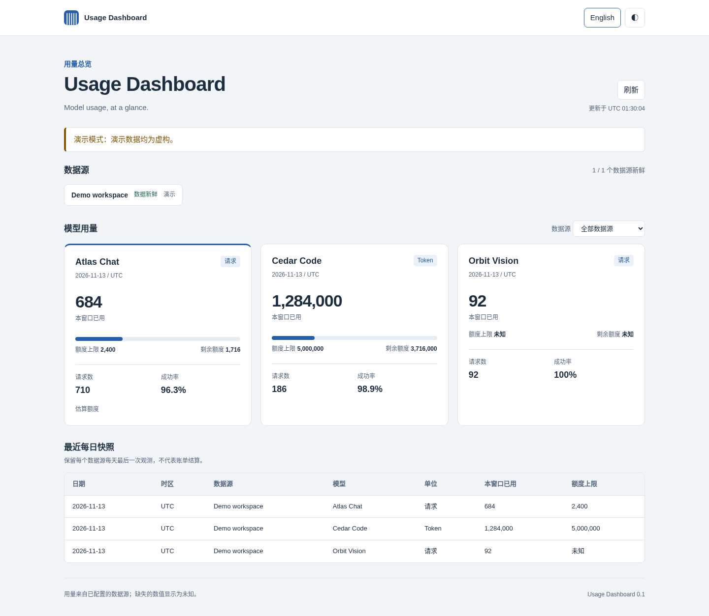

# Usage Dashboard

A small, read-only dashboard for model usage and quotas. Bring aggregate data from your own services; keep credentials and account records on the server.

[简体中文](README.zh-CN.md) · [Source contract](docs/data-contract.md)



## What it does

- Multiple configurable sources: synthetic demo, local JSON file, HTTP JSON, and a Naoya realtime-summary adapter.
- Request and Token quotas, remaining balances, source freshness and success rates when outcomes are complete.
- Model aggregation only across matching units and daily windows. Unknown balances stay unknown; failed sources cannot look healthy.
- SQLite daily snapshots, with configurable retention. No upstream database access.
- English/Chinese interface, light/dark themes, mobile layout and source filtering.
- Python 3.11+ standard library at runtime on systems with IANA timezone data. No frontend build, CDN or analytics.

## Try it

From the project directory:

```sh
python3 -m usage_dashboard
```

Open `http://127.0.0.1:8900`. The default is **fictional demo data**; it makes no external requests. Press Ctrl+C to stop. Windows: use `python` and install timezone data if needed (`python -m pip install tzdata`).

For a Chinese demo:

```sh
python3 -m usage_dashboard --config examples/config.demo.json
```

Optional installation in your virtual environment:

```sh
python -m pip install .
usage-dashboard --version
usage-dashboard --config /path/to/config.json
```

The package name is a local packaging identifier, not a claim of a published PyPI release.

## Use your own data

Copy `examples/config.http.json` to `config.json`, change the source URL, and set the named environment variable using your deployment's secret mechanism. Never put tokens in the URL, frontend or repository. Config uses **environment variable names**, not secret values.

```json
{
  "site": {"title": "Team Usage", "description": "Our model usage.", "language": "en"},
  "timezone": "UTC",
  "data_dir": "data",
  "sources": [{
    "id": "team", "label": "Team workspace", "type": "http",
    "url": "https://metrics.example.com/usage.json",
    "bearer_env": "USAGE_SOURCE_TOKEN"
  }]
}
```

```sh
python3 -m usage_dashboard --config config.json --check
python3 -m usage_dashboard --config config.json
```

`--check` validates configuration without fetching sources or creating a database. Configuration changes require a restart. Paths are relative to the config file, not the current shell directory. With no config, `data/` is relative to the current directory.

Your exporter must return the [aggregate JSON contract](docs/data-contract.md). This does not directly read arbitrary OpenAI-compatible APIs, new-api databases or Prometheus metrics. Examples include a file source and a Naoya adapter. The static `examples/snapshot.json` is a shape illustration: its old date is intentionally stale. Real exporters must update the observation timestamp and daily window from real measurements, preferably via atomic file replacement.

| Setting | Default | Meaning |
| --- | --- | --- |
| `host`, `port` | `127.0.0.1`, `8900` | Listen address; CLI `--host` / `--port` override |
| `timezone` | `UTC` | Clock display timezone; source quota windows remain independent |
| `poll_interval` | `30` | Seconds after each collection cycle before the next cycle |
| `stale_after` | `120` | Maximum accepted observation age, seconds |
| `timeout` | `5` | Per-operation source network timeout, seconds |
| `history_days` | `30` | Snapshot retention, 1–365 days |
| `data_dir` | `data` | Local SQLite directory; keep it outside version control |
| `site.language` | `en` | Initial UI language: `en` or `zh-CN`; visitors can switch |
| `sources[].enabled` | `true` | Disable collection and hide current data/history for a source |

Use distinct source IDs (letters, digits, underscores and hyphens). At most 32 sources, sampled sequentially. Only configure non-overlapping pools; monitoring the same pool twice doubles its numbers. Source HTTP responses are limited to 2 MiB, redirects are refused, and ambient proxy environment variables are ignored. Remote HTTP is refused; use HTTPS or a local tunnel. Proxy configuration inside an exporter is your responsibility.

## Docker

```sh
docker compose up --build -d
```

The included Compose starts a demo at `127.0.0.1:8900`, as UID 10001, with read-only root filesystem, a named data volume and resource limits. It does not mount Docker's socket or provider data. The image contains no credentials or local runtime data. To use real data, add a private override file:

```yaml
# compose.local.yaml (do not publish real deployment config)
services:
  dashboard:
    command: ["python", "-m", "usage_dashboard", "--host", "0.0.0.0", "--config", "/app/config.json"]
    volumes:
      - ./config.json:/app/config.json:ro
    environment:
      - USAGE_SOURCE_TOKEN
```

Set `data_dir` to `/app/data` in that mounted config, then run:

```sh
docker compose -f compose.yaml -f compose.local.yaml up --build -d
```

For file sources, mount only the aggregate JSON file read-only. Inside a container `127.0.0.1` refers to that container; for a Naoya source use a reachable HTTPS URL or deliberately arranged local tunnel. The loopback host mapping is suitable for an authenticated HTTPS reverse proxy. The image's health check tests process liveness, not source readiness.

## Privacy and deployment

The dashboard is a **read-only public aggregate view**, with no built-in authentication. Anyone who can reach it can see configured sources and their history. Put it behind your own HTTPS/authentication proxy for private use. Do not expose the development-sized Python HTTP server directly to hostile public traffic. Protect the config, environment and data directory with filesystem permissions; the CLI sets a restrictive creation umask.

Only allowlisted fields are published and stored; upstream account records, URLs, headers and raw errors are discarded. Allowed IDs/labels are still your public content: do not put secrets in them. History is local and is never sent anywhere automatically. Removing/disabling a source hides its historical records but does not erase the stored database. Disabled source names remain visible with a disabled status; remove their configuration entirely to hide their names. Shared/private business pools must be separated by configuration and deployment.

No model generation, account maintenance, billing enforcement, official quota lookup, automatic discovery or provider login-queue operation is implemented. Observed usage and quota estimates are not invoices or guaranteed capacity. Historical data starts with this installation; there is no migration from an existing service/database.

## Development

```sh
python3 -m unittest discover -s tests -v
python3 -m usage_dashboard --config examples/config.demo.json --check
```

Tests use synthetic files and temporary loopback HTTP servers, never provider credentials or model calls. CI covers Python 3.11–3.13 and container builds. Optional browser checks use Playwright and a running local demo:

```sh
npm install --no-save --package-lock=false playwright
npx playwright install chromium
# In another terminal, run: python3 -m usage_dashboard
DASHBOARD_URL=http://127.0.0.1:8900 node tests/browser.mjs
```

Runtime code uses only Python's standard library; Playwright is an optional developer tool. See [release notes](CHANGELOG.md) for validation scope.

## License and provenance

MIT. This portable implementation was written independently from the requirements of a site-specific usage dashboard; it does not bundle that deployment's source files, data, branding or credentials. It is not affiliated with model providers or Naoya. Names in the demo are fictional. Third-party services and their access terms remain their owners' responsibility.

To create a source release, run `python3 tools/release.py`. It writes a deterministic ZIP and per-file manifest under `dist/` from an explicit allowlist, excluding private config, runtime data, caches and Git history. Review the resulting file list and contents before publishing; the allowlist is not a substitute for a secret/content audit.
