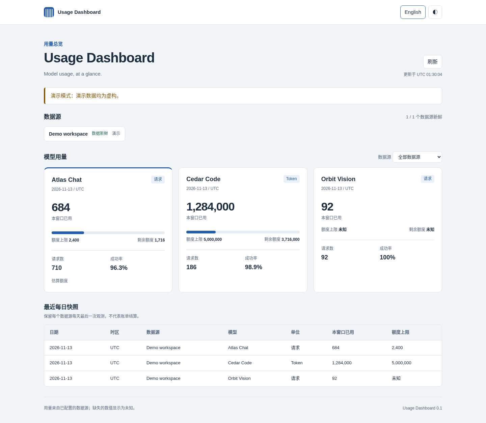

# Usage Dashboard · 模型用量看板

把自己的模型服务用量整理成一个可分享的只读页面。支持多个数据源、请求与 Token 额度、剩余额度、数据新鲜度和每日历史快照。

[English / 完整配置说明](README.md) · [数据格式与统计口径](docs/data-contract.md)



## 本机启动

需要 Python 3.11 或更新版本，Linux 需安装系统时区数据。没有前端构建步骤，也不依赖 CDN。Windows 可用 `python` 命令，缺失时区数据库时执行 `python -m pip install tzdata`。

```sh
python3 -m usage_dashboard --config examples/config.demo.json
```

打开 `http://127.0.0.1:8900`。默认演示使用**虚构数据**，不会访问外部服务，也不会调用模型。界面支持中英文、明暗主题、手机布局和按源筛选。Ctrl+C 停止。

也可用 `docker compose up --build -d` 启动演示；Docker 详细配置见英文说明。

## 接入自己的服务

支持四种数据源：

| 类型 | 用途 |
| --- | --- |
| `demo` | 无需凭据，直接预览 |
| `file` | 读取本地聚合 JSON 文件 |
| `http` | 从 HTTPS 或本机 HTTP 获取聚合 JSON，可引用环境变量中的 Bearer Token |
| `naoya` | 用环境变量中的控制台凭据登录后读取实时汇总；仅适配文档所列数据格式 |

从 `examples/` 复制合适的配置到自己的 `config.json`，修改标题、数据源和时区。路径相对于配置文件。把真实密钥放到环境变量中，配置文件只写变量名。

```sh
python3 -m usage_dashboard --config config.json --check
python3 -m usage_dashboard --config config.json
```

配置校验不会取数或创建数据库。修改配置后需重启。标准数据示例：

```json
{
  "generated_at": "2026-01-01T12:00:00Z",
  "window": {"date": "2026-01-01", "timezone": "UTC"},
  "models": [{"id": "my-model", "label": "我的模型", "unit": "requests",
              "used": 120, "limit": 1000, "requests": 125,
              "successes": 120, "failures": 5, "estimated": true}]
}
```

示例日期只是格式说明。实际导出器必须提供**当前窗口和实际观测时间**；旧数据不能仅靠修改时间戳伪装为新数据。未知额度传 `null`，不要填 0；`unit` 可为 `requests` 或 `tokens`。

## 统计边界

- 模型 ID、单位、日期、时区都相同才合并。每个源必须代表不重叠的用量池，同一个池不能配两遍。
- 部分源失效时，只显示新鲜源的部分用量，总额度及余额保持未知；不会沿用旧余额伪装正常。
- 额度是数据源报告值，不是官方保证的容量。已用量和请求次数可以不同；支持上游独立报告封顶后的剩余额度。
- 请求结果不完整时不展示成功率。共享 Token 池单独展示一次，不分摊成多个独立余额。
- 时区显示可配置，但不改变源的日额度窗口。第一版只支持日历日，不支持月度或滚动窗口。
- SQLite 保存每源每天最后一次观测，重复采集替换快照，不累加。不是账单，也无法补回安装前或停机期间遗漏的历史。

## 部署与隐私

看板没有内置登录；能访问页面的人就能看到已配置数据源的聚合数据及历史。默认只监听本机。对外使用应放在自己的 HTTPS／身份验证反向代理后，不要直接向不可信公网暴露 Python HTTP 服务。

不会读取账号数据库、执行生成、操作账号或登录队列。接口只输出白名单聚合字段，凭据不会发到浏览器。允许输出的模型名称和数据源名称仍需自行确保不含隐私。默认不自动上传任何数据。

`data/`、环境文件、私有配置与凭据都不能上传。Naoya 仅验证了合成数据适配，不保证兼容所有版本；接真实服务前先核对其汇总格式。其他提供商可以用小型导出器接入标准 JSON，第一版没有自动识别任意 API 的能力。

## 验证与许可

```sh
python3 -m unittest discover -s tests -v
```

所有测试只使用虚构数据和本机临时服务。项目采用 MIT 许可证；当前实现独立编写，不包含原站点部署文件、商标、凭据或业务数据。发布状态和验证范围见 [CHANGELOG](CHANGELOG.md)。
